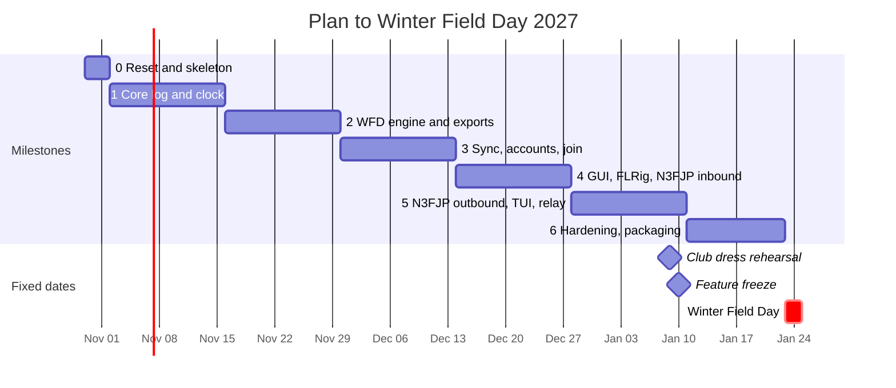
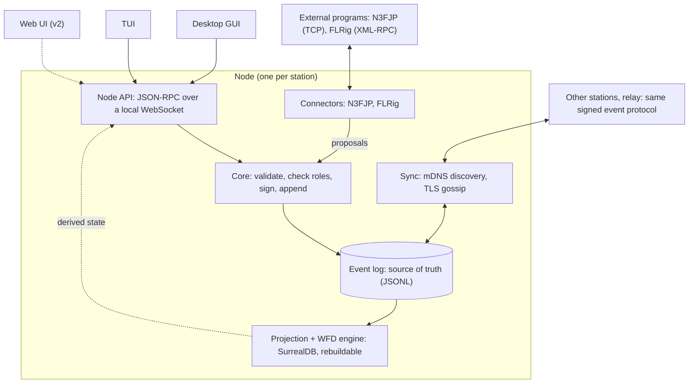

# KE8YGW Logger v1 Design Spec

Austin Hadley, KE8YGW · written Oct 29, 2026 · decisions updated Oct 30, 2026

> This file is the master copy of the spec from Milestone 0 on. Change it through pull requests; the Claude Doc it was exported from is a read-only snapshot.

KE8YGW Logger v1 is a peer-to-peer, offline-first logger that lets 2 to 10 stations at one Winter Field Day site log into one merged, scored, exportable log. It must be on the air for **Winter Field Day, Jan 23-24, 2027** (rules: [WFD 2027 v3](https://winterfieldday.org/downloads/2027-rules-v3.pdf)). This spec is written for Claude Code to implement; where it says "decision", build it that way.

## 1. Overview and goals

**Who it is for.** A club operating under one callsign with several stations, plus the operators and checkers working them. Single-operator use must also work, as a one-node event.

**v1 goals**

- Several stations log at once and every station sees every QSO within about 1 second on a LAN, with no Internet.
- Duplicate checks work across all stations, including while the network is split.
- The WFD 2027 score (QSO points × (OM+1)) and objective tracking are live and correct.
- Cabrillo and ADIF exports that winterfieldday.org accepts.
- Two-way sync with N3FJP, and rig control through FLRig.
- No QSO is ever lost: a crash or power cut loses nothing that was acknowledged on screen.

**Non-goals for v1:** POTA/SOTA workflows, state QSO parties, N1MM+, Log4OM, HamRS, QRZ and Club Log, UBN reports, web UI, mobile, third-party plugins, AI features.

**Locked decisions**

| Area | Decision |
| --- | --- |
| Repo | Same repo; tag v0.5.1-final and keep an archive/v0 branch, then delete everything and restart. Any v0.5.1 code that fits the new design may be ported after review |
| Language and core | Rust workspace, first-party connectors behind traits |
| Source of truth | Per-station hash-chained JSONL logs merged as a DAG; embedded SurrealDB is a rebuildable projection only |
| Sync | Peer-to-peer, hybrid logical clocks (HLC), mDNS discovery required, Internet relay optional |
| Time source | NTP first, then GPS, then the designated master laptop |
| Accounts | Per-operator accounts; join by URL, QR code or mDNS; roles: admin, operator, checker, viewer. Operators pick their name to log in; admins and checkers also enter a PIN |
| Checker role | May edit and tombstone other stations' QSOs |
| Dupes | Gossip every QSO; earliest HLC wins; staleness badge when a peer is out of contact |
| Contests | Definitions are versioned data files (`wfd-2027`) plus Rust rule kinds |
| Platforms | Windows, macOS and Linux all first-class, plus Raspberry Pi (aarch64 Linux) for headless nodes; v1 = desktop GUI + TUI, v2 = web UI, v3 = mobile |
| Integrations in v1 | N3FJP two-way, FLRig, ADIF/Cabrillo files; N1MM+ two-way comes after v1 |
| Plugins | No dynamic plugins in v1; WASM host in v2 |
| Grant | ARDC grant set aside for now |
| License | MIT, unchanged from v0.5.1 |
| Public relay | Project owner's Vultr VPS at ke8ygw.h2tech.dev |
| Spec master copy | docs/V1\_DESIGN\_SPEC.md in the repo, from Milestone 0; changes go through PRs |

## 2. Scope and milestones

v1 is the whole path for one event, Winter Field Day: log, sync, score, export, N3FJP, FLRig, GUI and TUI. Everything else waits.



The plan has 12 weeks from Monday Nov 2. The club dress rehearsal is Sat Jan 9 and the feature freeze is Sun Jan 10; the last two weeks are fixes only. Logs are due at winterfieldday.org by 23:59 UTC on March 1.

| Milestone | Done when |
| --- | --- |
| 0 Reset and skeleton | Old code deleted; Rust workspace builds and tests on Linux, Windows and macOS in CI, plus an aarch64 Linux check for the Raspberry Pi; this spec lives in `docs/V1_DESIGN_SPEC.md` |
| 1 Core log and clock | Signed events, HLC, per-station JSONL with verify and repair, projector into SurrealDB, CLI to append and verify; the `kill -9` durability test passes |
| 2 WFD engine and exports | `wfd-2027.toml`, exchange parsing, dupes, points, objectives, live score; Cabrillo and ADIF with preflight; golden tests pass |
| 3 Sync, accounts, join | mDNS, TLS gossip, join with approval, roles, merge and conflicts; partition simulation and property tests converge |
| 4 GUI, FLRig, N3FJP inbound | Entry, log, score, objectives, stations and export screens; FLRig connector with multi-radio config; N3FJP inbound against the real program, ready for the Jan 9 rehearsal |
| 5 N3FJP outbound, TUI, relay | N3FJP outbound adds against the real program; minimal TUI; relay at ke8ygw.h2tech.dev; network helper on Linux and Windows |
| 6 Hardening, packaging | Rehearsal fixes, installers for three OSes (Windows signed, macOS notarized), 2-hour 10-node soak test, operator quick-start |

**After v1** (no dates yet): N1MM+ two-way, Log4OM, HamRS, QRZ, Club Log, state QSO party definitions, ARRL Field Day (June), UBN-style checking, POTA/SOTA workflows. **v2:** web UI and the WASM plugin host. **v3:** mobile.

**Cut line.** If the schedule slips, drop in this order and stop as soon as it fits:

1. Public relay and the **Host a station network** helper (mDNS on an existing LAN still works)
2. TUI features beyond entry, recent log and peers
3. QR join (URL and mDNS join stay)
4. N3FJP outbound edits and deletes, then N3FJP outbound adds

Never cut: signed log, merge, sync, the WFD engine, exports, FLRig, or N3FJP inbound.

## 3. Architecture

Each station runs one **node**, and the node is the only thing that touches the log.



The event log is the only authoritative data. The dashed web UI is planned for v2.

Screens send requests and connectors send proposals to the core, which is the single writer. The projection (SurrealDB plus the WFD engine) pushes derived state back up through the Node API: dupe flags, score, objectives and notifications.

**Rust workspace**

| Crate | Responsibility |
| --- | --- |
| `ke8ygw-types` | Ids, event envelope, QSO and HLC types; no I/O |
| `ke8ygw-hlc` | Hybrid logical clock and time sources (NTP, GPS, master offset) |
| `ke8ygw-identity` | Ed25519 keys, signing, operator accounts, PIN verifiers |
| `ke8ygw-eventlog` | Per-station JSONL chains, verification, repair, DAG heads |
| `ke8ygw-merge` | Merge, tombstones, conflicts, role checks |
| `ke8ygw-sync` | mDNS, TLS transport, gossip protocol, join flow, relay client |
| `ke8ygw-netsetup` | Per-OS hotspot and ad-hoc helper |
| `ke8ygw-projector` | Replays events into embedded SurrealDB |
| `ke8ygw-contest` | Definition loader, rule kinds, WFD 2027 engine, section list |
| `ke8ygw-export` | Cabrillo, ADIF, submission summary, preflight |
| `ke8ygw-proposal` | Proposal types shared by connectors and core; no runtime dependencies |
| `ke8ygw-connector-n3fjp`, `ke8ygw-connector-flrig` | First-party connectors |
| `ke8ygw-node` | Wires everything together and serves the Node API |
| `ke8ygw-gui`, `ke8ygw-tui`, `ke8ygw-relay` | The user-facing binaries |
| `ke8ygw-testkit` | Simulated network, fake N3FJP and FLRig servers, fixtures |

**Conventions.** Tokio for async. `#![forbid(unsafe_code)]` everywhere except the OS-specific parts of `ke8ygw-netsetup`. Errors with `thiserror`, logging with `tracing`. Network input never panics: it returns an error and the peer is logged and kept at arm's length. Every crate is built and tested on Linux, Windows and macOS in CI.

## 4. Event log, identity and HLC DAG

Every fact is an immutable, signed event. Each station appends only to its own hash-chained log, and the merged view is the union of all stations' logs. The old single linear chain is retired because it cannot take concurrent writers.

**Identity and trust**

- On first run each node creates an Ed25519 **station key**. `station_id` = base32 of the BLAKE3 hash of the public key, first 10 bytes.
- Events are signed by the station key and stamped with the `operator_id` of whoever is logged in. Threat model for v1: honest-but-clumsy club members. Signatures give attribution and tamper evidence, not defense against a malicious station.
- Operator accounts are created by an admin (`operator.added`). Operators log in at a station by picking their name. Admins and checkers also enter a PIN; its argon2id verifier rides in the signed log (`operator.pin_set`), so one PIN works at every station and unlocks edit, tombstone, approve and export.
- An admin can revoke a station key (`station.revoked`); events from it after the revocation HLC are kept but ignored.

**Envelope** (canonical form: RFC 8785 JSON; `id` = BLAKE3 of the canonical bytes without `id` and `sig`; `sig` signs `id`)

```json
{
  "v": 1,
  "id": "<hex>",
  "event_id": "<uuid-v7 of the operating event>",
  "station": "<station_id>",
  "seq": 124,
  "prev": "<id of this station's event seq-1>",
  "parents": ["<ids of other stations' latest events seen at write time>"],
  "hlc": { "wall_ms": 1798038130000, "counter": 0, "node": "<station_id>" },
  "operator": "<operator_id>",
  "type": "qso.logged",
  "body": {},
  "sig": "<hex>"
}
```

**Event types in v1**

| Type | Purpose |
| --- | --- |
| `event.created`, `event.rules_set`, `event.exchange_locked` | Event setup: callsign, rules id and version, sent exchange |
| `station.joined`, `station.revoked`, `station.status` | Membership; band/mode/radio claims; max power attestation |
| `operator.added`, `operator.role_changed`, `operator.removed`, `operator.pin_set` | Accounts, roles and admin/checker PIN verifiers |
| `operator.shift_started`, `operator.shift_ended` | Who is at which station (feeds the six-hours objective) |
| `qso.logged`, `qso.edited`, `qso.tombstoned`, `qso.restored` | The log itself |
| `objective.claimed`, `objective.revoked`, `evidence.added` | Objectives and their proof; non-QSO contacts live here |
| `antenna.registered` | Antenna registry (pre-installed flag), used by the multiple-antenna objective |
| `clock.sample` | Offset and source (NTP, GPS, master) used for time correction |

**`qso.logged` body**

```json
{
  "qso_id": "<uuid-v7>",
  "ts_utc": "2027-01-23T16:42:10Z",
  "call": "W1AW",
  "band": "20m",
  "freq_hz": 14250000,
  "mode": "USB",
  "mode_group": "PH",
  "radio_id": "rig1",
  "antenna_id": "dipole-a",
  "rcvd": { "class_num": 3, "category": "H", "section": "EMA" },
  "extras": { "rst_s": "59", "rst_r": "59", "grid": "FN31", "power_w": 100, "comment": "" },
  "source": { "kind": "manual", "ref": null }
}
```

The sent exchange is not stored per QSO; it comes from `event.exchange_locked`. Dupe, out-of-window and rule-violation flags are derived by the projector and never stored in events.

**Merge rules**

- Presentation order is `(hlc, station, seq)`.
- Sync = exchange per-station heads, request missing ranges, verify hash chain and signature, then append to the peer's chain file. A gap in `seq` means a missing range; request it.
- `qso.edited` carries `target`, `base` (the version edited) and a field patch. Concurrent edits resolve per field by latest HLC and raise a **conflict** entry for the checker queue.
- `qso.tombstoned` is final unless a checker or admin issues `qso.restored`. Edits after a tombstone are kept but ignored.
- Events from a station that arrive with `wall_ms` more than 5 minutes ahead of local corrected time are accepted, flagged, and surfaced in the clock panel.

**Time.** HLC follows Kulkarni et al. The node corrects wall time by the best available source in this order: NTP, GPS (gpsd or NMEA), then the admin-designated master laptop (offset estimated in the sync handshake, NTP-style). Warn when any peer is more than 2 seconds apart. `ts_utc` on a QSO is the corrected time at entry.

## 5. Sync and networking

Nodes find each other with mDNS, connect directly to every peer, and gossip each new event immediately, with a periodic head exchange to repair anything missed. The Internet is optional and only ever carries the same signed events.

**Discovery.** DNS-SD service `_ke8ygw._tcp.local` on IPv4 and IPv6 (use the `mdns-sd` crate). TXT records: `v=1`, `ev=<first 8 bytes of BLAKE3(event_id)>`, `st=<station_id>`, `name=<station label>`. The event id is hashed so strangers on the same network cannot read it. Always offer a manual fallback: type `host:port` or scan a QR, because many Wi-Fi access points block multicast between clients.

**Transport.** TCP with TLS 1.3 (rustls). Each node's certificate is self-signed from its station key; peers are pinned to the station keys recorded in `station.joined`. Messages are length-prefixed JSON frames (debuggable now; swap to CBOR later if needed).

| Message | Meaning |
| --- | --- |
| `hello` | Protocol version, station id, event id hash |
| `heads` | Map of station id to (latest seq, latest event id) |
| `want` | Ranges of (station, seq) the sender is missing |
| `events` | A batch of events, in per-station seq order |
| `push` | One new event, sent to all peers the moment it is appended |
| `ping` | Keepalive and round-trip/offset estimate, every 2 s |

Targets on a healthy LAN: a new QSO is visible on every peer in under 500 ms; a node that rejoins after 30 minutes offline is caught up in under 5 seconds at 5,000 QSOs. Full mesh (up to 10 nodes); when two nodes dial each other at once, keep the connection initiated by the lower station id.

**Joining an event**

1. The admin creates the event and gets a **join token**: `{event_id, admin station pubkey, relay URLs, one-time secret, role, expiry}` signed by the admin station (24 h default expiry).
2. The token is shown as a URL (`https://ke8ygw.h2tech.dev/join#<token>`) and as a QR code that encodes `ke8ygw://join#<token>`. The installer registers the `ke8ygw://` scheme, so scanning the QR opens the app with no Internet; online, the https page hands off to the app. A joiner can also pick the event from the mDNS list and enter the token or a short code.
3. The joiner connects, proves the secret, and sends its public key, callsign and label.
4. The admin's screen shows an approval prompt. On approval the admin appends `station.joined` (and `operator.added`), and the joiner receives the full history.

**Network setup helper.** A single button, **Host a station network**, with an in-app consent step before any system change. It sits behind a per-OS `netsetup` trait:

| OS | v1 behavior |
| --- | --- |
| Linux | NetworkManager hotspot or true ad-hoc (IBSS) via `nmcli` |
| Windows | Mobile Hotspot through the Windows tethering API; Wi-Fi Direct where the adapter supports it |
| macOS | Show step-by-step Internet Sharing instructions (not scriptable) |

Only Linux can run real ad-hoc mode today; Windows, macOS, iOS and Android have dropped or never had it, which is why the hotspot and Wi-Fi Direct routes exist.

**Optional relay.** `ke8ygw-relay` is a single self-hostable binary speaking the same protocol over WSS. It stores and forwards signed events and cannot forge them. The relay URL and its token ride inside the join token, so a self-hosted relay needs no code change. The public relay runs on the project owner's Vultr VPS at `wss://ke8ygw.h2tech.dev`. `.dev` domains are HTTPS-only, so the VPS needs a DNS record and a real certificate (Let's Encrypt) before join pages or the relay work.

## 6. Roles, accounts and permissions

Four roles, enforced by every node at merge time using the role in force at the event's HLC. An event that breaks the matrix is kept in the log, marked `unauthorized`, and left out of projections, scores and exports.

| Action | Admin | Operator | Checker | Viewer |
| --- | --- | --- | --- | --- |
| Log a QSO at their station | Yes | Yes | Yes | No |
| Edit or tombstone their own QSOs | Yes | Yes | Yes | No |
| Edit or tombstone other stations' QSOs | Yes | No (can flag) | Yes | No |
| Resolve conflicts, restore tombstoned QSOs | Yes | No | Yes | No |
| Add objective evidence | Yes | Yes | Yes | No |
| Claim or revoke objectives | Yes | No | Yes | No |
| Approve joins, revoke stations, change roles | Yes | No | No | No |
| Change locked exchange or rules after the first QSO | Yes (with confirm) | No | No | No |
| Export Cabrillo and ADIF | Yes | No | Yes | No |
| View log, score, rate, peers | Yes | Yes | Yes | Yes |

**Event lock.** Under WFD 2027 the class, category and location identifier must stay the same for the whole event. `event.exchange_locked` is written when the first QSO is logged; changing it afterwards is an admin-only action behind an explicit warning and is recorded as its own event.

**Operators at stations.** One operator is logged in per station at a time; `operator.shift_started` and `operator.shift_ended` record changes. The station board shows who is on which radio, band and mode.

**Backup admin.** Event setup recommends naming a second admin and warns when there is only one, but does not require it, so a one-node event still works. Any admin can act from any station.

## 7. Dupe checking and partition behavior

A QSO is a dupe when the same station was already worked on the same band and mode group. The earliest HLC wins; every later one is kept in the log, scores zero, and is shown as a dupe.

**WFD 2027 dupe key:** `(normalized_call, band, mode_group)` with `mode_group` in `CW`, `PH`, `DIG`. A station can therefore be worked once per band-mode, at most three times per band ([rules](https://winterfieldday.org/downloads/2027-rules-v3.pdf)). `normalized_call` uppercases and strips portable suffixes (`/P`, `/M`, `/QRP`); keep this as a definition option so other contests can differ.

**Entry-time check.** As the call is typed, query the merged local view and show one of three states:

| State | Shown when | Behavior |
| --- | --- | --- |
| Clear | No match, and every peer synced within 15 s | Log normally |
| Dupe | A match exists (shows which station and when) | Warn; operator may still log it, it scores 0 |
| Unverified | No match, but a peer has not synced for more than 15 s | Warn with the count of out-of-contact stations; log normally |

**After a merge.** If a QSO becomes a dupe because an earlier one arrived from another station, it is demoted automatically, a notice is shown at the station that logged it, and it goes to the checker queue. Nothing is deleted.

**Other WFD rule checks at entry** (all warnings, never blockers, so an operator can always log what actually happened):

- Band 12, 17, 30 or 60 m, or a WSJT-family mode (FT8, FT4, FT2, FST4, JT4, JT9, JT65, Q65, MSK144, WSPR, FST4W, Echo): flagged as not creditable.
- Time outside the operating window: flagged as out of window.
- Two stations transmitting on the same band and mode at once is prohibited. Each station publishes `station.status` claims (band, mode, radio); a conflicting claim shows a warning on both stations. The claim is advisory and never blocks logging.
- Contacts with anyone at the operation's own site do not count; a checkbox on the entry form marks a contact as "on site" and excludes it.
- Power above 100 W PEP: every station is limited to 100 W PEP, so a logged `power_w` over 100 is flagged.
- Relayed or linked contacts: cross-band, repeater, relayed, mesh and Internet-linked contacts do not count. A **via** choice on the entry form marks such a contact and excludes it from points and exports.

## 8. Contest definitions and the WFD 2027 engine

A contest is a versioned TOML file in `contests/` (here `wfd-2027.toml`) that names the rule kinds the Rust engine should apply. Rules change every year, so each version is its own file and `event.rules_set` records the id and the file's hash. Anything data cannot express (for example "three QSOs on each of N bands") is a named rule kind implemented once in Rust and configured from the file.

```toml
id = "wfd"
version = "2027"
source = "https://winterfieldday.org/downloads/2027-rules-v3.pdf"
rules_date = "2026-10-04"

[window]                      # 30-hour operating period; setup allowed from 16:00Z Friday, max 12 h total
start = "2027-01-23T16:00:00Z"
end   = "2027-01-24T21:59:59Z"

[exchange]                    # sent and received: class number, category letter, section
class_num = { type = "int", min = 1 }
category  = { type = "enum", values = ["H", "I", "O", "M"] }
section   = { type = "list", file = "sections.toml", extra = ["MX", "DX"] }
entry_pattern = '^(\d{1,2})([HIOM])\s+([A-Z]{2,4})$'    # e.g. "2M EPA"
locked_for_event = true

[bands]
excluded = ["12m", "17m", "30m", "60m"]

[modes]
groups = { CW = ["CW", "MCW"], PH = ["SSB", "USB", "LSB", "AM", "FM", "DMR", "C4FM"], DIG = ["*"] }
excluded = ["FT2", "FST4", "FT4", "FT8", "JT4", "JT9", "JT65", "Q65", "MSK144", "WSPR", "FST4W", "ECHO"]

[dupe]
key = ["call", "band", "mode_group"]
call_normalization = "strip_portable"

[points]
PH = 1
CW = 2
DIG = 2

[score]
formula = "qso_points * (1 + objective_multiplier)"
```

**Score.** Total score = QSO points × (OM + 1), where OM is the sum of completed objectives and the +1 is for participating. Only creditable, non-dupe, in-window QSOs earn points. Satellite objectives were removed for 2027.

**Objectives (13).** By our sum the maximum OM is 34; check this against WFDA's submission form before the event.

| Id | Objective | OM | How the app tracks it |
| --- | --- | --- | --- |
| `alt_power_equipment` | All station equipment, including laptops and network gear, on alternative power | 1 | Attestation; auto-granted when `alt_power_100` is claimed |
| `alt_power_100` | 100% alternative power, including lights and HVAC | 2 | Attestation |
| `away_from_home` | Station more than half a mile from home | 3 | Attestation, optional coordinates |
| `multi_antenna` | Two or more newly deployed antennas, at least one contact on each | 1 | Auto-derived from `antenna.registered` (not pre-installed) and per-QSO `antenna_id` |
| `sstv_image` | Send and receive the official WFD SSTV image in a WFD QSO | 2 | Evidence: link the sent and received QSOs, optional image files |
| `crossband_repeater` | Set up a cross-band repeater and make at least 3 contacts through it | 3 | Evidence entries only; these are not QSOs and are never scored or exported |
| `winlink` | Send and receive at least one Winlink email over amateur RF | 1 | Evidence entries (message ids and times) |
| `bulletin` | Accurately copy the WFD Bulletin and submit the copy | 1 | Evidence: pasted text, included in the export summary |
| `bands_6` | At least 3 QSOs on each of at least 6 bands | 6 | Auto-derived from creditable QSOs |
| `bands_12` | At least 3 QSOs on each of at least 12 bands | 6 | Auto-derived |
| `multi_mode` | At least one QSO on two or more mode groups | 2 | Auto-derived |
| `qrp` | Every station at 10 W or less on phone, 5 W or less on CW or digital, the whole event | 4 | Per-station power attestation in `station.status`; blocked if any logged `power_w` exceeds the limit |
| `six_hours` | Six continuous hours of operating | 2 | Helper: longest coverage from `operator.shift_*` events; the admin confirms |

Auto-derived objectives show as **Achieved**, **In progress (n of 3)** or **Not met**. Manual ones show a checklist with an evidence panel. Claims are events, so every station sees the same state.

**Exchange rules.** Class number, category letter and location identifier are fixed for the whole event, even if the operation moves between sections. Received exchanges are parsed with `entry_pattern`; the section list ships as `sections.toml`, sourced from the official ARRL and RAC lists, cross-checked against the LOCATION choices on WFDA's submission form, and covered by a unit test. Do not type the list from memory. The 300 m site circle and "no remote operation" rule are attestations in event setup.

**Live scoring panel.** QSO points by mode group, OM selected, final score, 10-minute and 60-minute rate, a band × mode-group count matrix with the 3-QSO thresholds highlighted, and per-station and per-operator contributions.

## 9. Exports: Cabrillo, ADIF and the submission summary

WFD accepts a Cabrillo or an ADIF file uploaded at winterfieldday.org by **23:59 UTC on March 1**; a corrected upload replaces the earlier one. Only the QSO lines are read, and a wrong field name gets the log rejected ([2027 rules](https://winterfieldday.org/downloads/2027-rules-v3.pdf)). The exporter must therefore validate before it writes.

**Preflight (blocks export on errors, lists warnings)**

- Every exported QSO has call, UTC date and time, band, mode, class and section.
- No excluded band or mode, nothing outside the operating window, no tombstoned or unauthorized events.
- File name is `<EVENTCALL>.log`, `.txt` or `.adi`, using the callsign actually used on the air.
- Dupes: preflight shows the dupe count and asks the admin on every export whether to include them. The claimed score never counts dupes.

**Cabrillo 3.0.** CRLF line endings and at least one space after every colon.

```
START-OF-LOG: 3.0
LOCATION: AL
CALLSIGN: K4SCO
CLUB: Jackson County Amateur Radio
CONTEST: WFD
CATEGORY-POWER: LOW
CLAIMED-SCORE: 1312
OPERATORS: KY4LV, W4OPS, W0MET
NAME: Fred Hampton
X-EXCHANGE: 3O
EMAIL: fred@fakemail.com
QSO: 14070 DG 2027-01-23 2131 K4SCO 3O AL N2WFD 1H WI
QSO: 28000 CW 2027-01-24 1701 K4SCO 3O AL W4NRR 2M MO
END-OF-LOG: 
```

- `LOCATION` is the ARRL/RAC section, `MX` or `DX`. `CATEGORY-POWER` is `QRP` only if the `qrp` objective is claimed, otherwise `LOW`. `OPERATORS` comes from the operator accounts that logged QSOs.
- QSO line: frequency in kHz (HF), mode `CW`, `PH`, `FM`, `RY` or `DG`, date, HHMM, our callsign, our exchange (`<class><category> <section>`), their callsign, their exchange. Do not use `SOAPBOX`.
- Frequency and band notes from the 2025 rules (HF in whole kHz; above 50 MHz use the band name such as `144`, `222`, `432`, `902`, `1.2G`) were not repeated in the 2027 text. Keep them as defaults and confirm against WFDA's submission page.

**ADIF 3.1.4.** The minimum fields are `CALL`, `QSO_DATE` (YYYYMMDD), `TIME_ON` (HHMMSS), `BAND` (for example `40M`), `MODE`, `CLASS` (their class and category, for example `1H`) and `ARRL_SECT`. Field names must match exactly. Add `FREQ`, `STATION_CALLSIGN`, `OPERATOR` and `SUBMODE` as extras (WFD ignores them). The sample ADIF in the 2027 PDF contains typos, so rely on the field names, not the sample.

**Submission summary.** Alongside the log, write `submission-summary.md`: event callsign, exchange, QSO points by mode group, completed objectives with OM, final score, and the evidence for each manual objective, including the bulletin text. The admin uses it to fill in the objectives form on the website.

## 10. Connectors: N3FJP, FLRig, and what comes later

A connector is a first-party crate implementing the `Connector` trait. It runs inside the node on the station, reconnects with backoff, reports health to the UI, and never writes the log directly: it emits **proposals** that the core validates, signs and appends.

### N3FJP (two-way, required for v1)

Source: [N3FJP API 2.2](https://www.n3fjp.com/help/api.html). N3FJP is the TCP **server** (default port 1100, enabled under Settings > Application Program Interface); our node is the client. Messages are `<CMD>...</CMD>` XML-like text ending in CR+LF, several may arrive in one packet, and actions need at least 5 ms between them. N3FJP is Windows software; the connector only needs TCP reach to it, so config is `host`, `port`, and which N3FJP program is in use.

The club will run N3FJP's **Winter Field Day Contest Log**, so build and test against that program first, and confirm its class field matches the 2027 naming.

**N3FJP to us**

1. On connect: `PROGRAM`, `APIVER`, `QSOCOUNT`, then `LIST` with `INCLUDEALL` for an initial import of every record.
2. On `ENTEREVENT`: the event carries only call, band, mode, date and time, so request `LIST INCLUDEALL` with value 1 to get the full newest record, then propose `qso.logged`.
3. On `EDITDELETEEVENT`: the event has no detail. After a 500 ms debounce, re-list all records, diff against the mapping table, and propose `qso.edited` or `qso.tombstoned` (these propagate network-wide; the station's operator needs rights, otherwise they raise a flag for the checker).
4. Every 60 s, compare `QSOCOUNT` with the mapping table and re-list on mismatch.

**Us to N3FJP (decision: direct add, not simulated typing)**

- Remote QSOs are written with `ADDADIFRECORD` (API 2.0 and later; fall back to `ADDDIRECT` followed by `CHECKLOG` on older programs). Direct add does not disturb whatever the local operator is typing. The cost is that N3FJP skips its own callbook lookup and contest scoring for those records, so **our app is the authoritative scorer** and N3FJP's displayed score is informational.
- The alternative (fill fields, `CONTESTEX`, `ENTER`) is not used because it types into the live entry form.
- Edits and deletes of remote QSOs are not writable through a documented command. For v1 show a "N3FJP log differs" banner with the count; an experimental flag `--n3fjp-sql-writeback` may apply them with `SENDSQLSTAYOPEN` after copying the `.mdb` (path from `FILEPATH`) to a backup. Off by default.
- Optional: forward our FLRig frequency and mode to N3FJP with `SENDRIGPOLL`.

**Field mapping**

| N3FJP | Our QSO |
| --- | --- |
| `fldCall` | `call` |
| `fldBand` (meters, such as `40`) | `band` |
| `fldMode`, `fldModeContest` (`CW`, `PH`, `DIG`) | `mode`, `mode_group` |
| `fldFrequency` (MHz) | `freq_hz` |
| `fldDateStr` (`YYYY/MM/DD`) + `fldTimeOnStr` (`HH:MM`) | `ts_utc` (confirm N3FJP is set to UTC) |
| `fldClass` | `rcvd.class_num` + `rcvd.category` (the API notes say Winter Field Day uses the class field for the category) |
| `fldSection` | `rcvd.section` |
| `fldOperator`, `fldComputerName` | `operator`, station label |

**Echo and identity.** Keep a node-local mapping table `n3fjp_key -> qso_id`. The key is the composite of date, time, call, band and mode unless the record list exposes a stable record id (check this first). Records we wrote into N3FJP are registered in the table before writing so they are never re-imported. If an N3FJP station already uses N3FJP's own networking, treat it as a leaf and do not run both syncs.

**Testing.** Ship a fake N3FJP TCP server implementing only the commands above for contract tests, plus a manual checklist against the real program (initial import, live entry, edit, delete, remote add, reconnect).

### FLRig (required for v1)

FLRig exposes XML-RPC over HTTP, default `127.0.0.1:12345` ([FLRig XML-RPC commands](http://www.w1hkj.com/flrig-help/xmlrpc_commands.html)).

- Read: `main.get_version`, `rig.get_xcvr`, `rig.get_vfo` (returned as a string in Hz), `rig.get_mode`, `rig.get_modes`, `rig.get_update`, `rig.get_AB`, `rig.get_split`.
- Write: `rig.set_frequency` (double, Hz) and `rig.set_mode` (integer index into the rig's own mode table).
- Poll about every 250 ms; emit ephemeral radio state to the UI. Publish a `station.status` claim only after band and mode have been stable for 2 s.
- Mode names are rig-native. Map them to `mode` and `mode_group`: voice modes to `PH`; `CW` and `CW-R` to `CW`; `RTTY`, `PKT`, `DATA` and similar to `DIG`; anything unknown prompts the operator once and remembers the answer per radio.
- FLRig silently ignores unknown mode strings, and a server option can ignore all XML-RPC mode changes, so after every set, read back and report a mismatch ([client notes](https://www.nuget.org/packages/Packet.Rig.Flrig)).
- Multiple radios per station are supported from the start: config is a list `{radio_id, host, port}`, one is the **active** radio feeding the entry form (hotkey to switch), and every QSO carries `radio_id`.
- Testing: FLRig has no headless mode, so write an in-process fake XML-RPC server and use it in CI.
- Implementation choice: a small hand-rolled XML-RPC client (`quick-xml` plus an HTTP client) is preferred over a heavy dependency.

### After v1

N1MM+ (two-way, live), Log4OM, HamRS, QRZ and Club Log, using the same trait. ADIF import and export ships in v1 as the universal file fallback for every logger.

## 11. Storage: JSONL logs and the SurrealDB projection

The JSONL logs on disk are the only authoritative data. Embedded SurrealDB holds a projection that can be deleted at any time and rebuilt by replaying the logs.

**On-disk layout**

```
<data>/events/<event_id>/
  own/<station_id>.jsonl        this station's chain: append, then fsync, before the UI shows a QSO as logged
  peers/<station_id>.jsonl      verified copies of other stations' chains
  snapshots/                    periodic copies and export bundles
<data>/state/                   node-local only: keys, connector mapping tables
```

- One JSON event per line. On startup verify every chain (hash, signature, seq continuity). If the last line is a torn write, truncate it, keep a `.corrupt` copy, and warn.
- A QSO is shown as logged only after its line is fsynced. The kill-and-restart test in section 14 depends on this.

**Projection.** A single projector task applies events in causal order (parents first, then HLC) and is idempotent by event id. The projector keeps a watermark; on a schema or watermark mismatch it drops the database and rebuilds. SurrealDB engine: file-backed SurrealKV by default (pure Rust, simpler builds), with an in-memory mode behind a flag for tests and small Raspberry Pi builds. At 20,000 QSOs a rebuild must finish in under 3 seconds.

| Table | Contents |
| --- | --- |
| `qso` | Current merged state of each QSO plus derived flags (dupe, out of window, not creditable, unauthorized) |
| `qso_version` | Edit history |
| `station`, `operator` | Membership, roles, status and claims |
| `objective`, `evidence` | Claims and proof |
| `conflict` | Open conflicts for the checker queue |
| `score_snapshot` | Cached score, rate and band-mode matrix |
| `watermark` | Last applied event per station |

The projector pushes change notifications to the node API; the UIs do not poll the database. Dupe lookup, rate and matrix queries are SurrealQL.

## 12. User interfaces: desktop GUI and TUI

Both UIs are thin clients of the node. The node exposes JSON-RPC 2.0 over a WebSocket on `127.0.0.1` (random port, token in a node-local file); the GUI, the TUI and the v2 web UI use the same API. The v2 web UI binds the same API to the LAN behind login.

**Binaries**

| Binary | What it is |
| --- | --- |
| `ke8ygw` | Desktop GUI. Tauri 2 shell with a Rust/WASM frontend (Yew, confirmed; it matches the author's other projects), embedding the node. The same frontend becomes the v2 web UI |
| `ke8ygw-tui` | Terminal UI (ratatui). Can embed a node or attach to a headless one |
| `ke8ygw-node` | Headless node for Raspberry Pi and servers |
| `ke8ygw-relay` | Optional relay |

**GUI screens (v1)**

1. **Entry.** Keyboard first. Callsign field with live dupe state (section 7), then one exchange field (`2M EPA`) that is parsed and validated, Enter to log, Esc to clear. Band, mode and frequency are filled from the active FLRig radio. Shows the station, operator and radio in use.
2. **Log.** The merged log with filters and role-gated edit and tombstone. Flags for dupe, out of window, not creditable, conflict and unauthorized.
3. **Score.** QSO points by mode group, objective multiplier, final score, 10-minute and 60-minute rate, the band × mode-group matrix, per-station and per-operator contributions.
4. **Objectives.** Auto-derived status and the manual checklist with evidence capture.
5. **Stations and network.** Peers with last-sync age and event counts, join approvals, QR and URL for joining, the **Host a station network** button, relay status, time source and skew, band-mode claim board.
6. **Event setup.** Callsign, rules version, locked exchange, site attestations, connectors.
7. **Export.** Preflight, Cabrillo, ADIF, submission summary.

Design for field use: high-contrast light and dark themes, large touch-friendly controls, readable in sunlight, no dependence on Internet fonts or assets.

**TUI (v1, minimal).** Entry, recent log, dupe state, score summary, peers, and objective toggles. Everything else is also reachable as CLI subcommands (`ke8ygw event create|join|approve`, `ke8ygw export cabrillo|adif`) so a headless Pi station is fully manageable.

## 13. Plugins roadmap

v1 ships no dynamic plugins. It does ship the boundary they will use, so v2 can add third parties without reshaping the core.

- **v1.** First-party crates implement three traits: `Connector` (section 10), `Exporter`, and the contest-definition loader (section 8, data-driven). All writes are **proposals**: a connector or any other producer submits a proposal, the core validates it against rules and roles, then signs and appends it. Nothing outside the core writes the log. AI features, if ever added, may only propose and may not append.
- **v2.** A WASM host (wasmtime, component model, WIT interfaces) for third-party connectors and contest engines. Capabilities such as network, serial and filesystem are granted per plugin by the host.
- **Why WASM rather than in-process libraries or child processes.** Rust has no stable ABI and a plugin crash would take the logger down mid-event; child processes cannot be spawned on iOS, which the v3 mobile plan needs. WASM is sandboxed, runs on every OS, and works on iOS in interpreter mode.
- Keep the proposal types in a small `proposal` crate with no runtime dependencies so they can be described in WIT later.

## 14. Testing, risks and open items

**Testing (all in CI on Linux, Windows and macOS unless noted)**

- Unit tests: HLC ordering and clock skew, canonical JSON and hash chain, signature verification, torn-write recovery.
- Property tests: random partitions, reordering and duplicate delivery across N simulated nodes must always converge to the same projection.
- Simulation harness: in-memory transport with latency, loss and partitions; scenarios include a 10-node event, a node offline for 30 minutes, and simultaneous dupes.
- Golden tests for scoring, dupe rules, objectives, Cabrillo and ADIF, using hand-computed fixtures including the WFD 2027 sample lines.
- Contract tests against the fake N3FJP and FLRig servers.
- Durability test: `kill -9` the node while logging at 5 QSOs per second; every QSO shown as logged must be present after restart.
- Soak test: 10 nodes, 20 QSOs per minute in total, 2 hours, no divergence.
- Hardware checks (manual): three real machines on a real access point with mDNS; the hotspot helper on Linux and Windows; real N3FJP and real FLRig with a rig.
- Club hardware at WFD 2027 is Windows laptops, Linux laptops and Raspberry Pis, with no Macs. Those get hands-on testing first, and CI adds an aarch64 Linux build for the Pi; macOS stays first-class in CI.
- **Dress rehearsal** with the club on Sat Jan 9, then feature freeze.

**Risks**

| Risk | Mitigation |
| --- | --- |
| 12 weeks is tight | Cut line in section 2; build the end-to-end path (log, sync, score, export) first |
| mDNS blocked by access-point client isolation | Manual `host:port`, QR and URL join; document a dedicated access point |
| Hotspot and ad-hoc behavior differs per OS | Per-OS trait, Linux and Windows only in v1, clear manual instructions elsewhere; verify each OS claim by hand |
| N3FJP behavior not fully documented (record identity, direct-add semantics, local dupe checks on added records, time zone) | Test against the real program in week 1 of the connector work; keep ADIF file import and export as the fallback |
| WFD rule details (maximum OM, Cabrillo frequency notes, typos in the PDF samples) | Re-read the 2027 PDF during the engine milestone and confirm with WFDA's helpdesk if unclear |
| Windows firewall prompts for mDNS and TCP | Installer adds rules after consent; first-run checklist in the UI |
| Embedded SurrealDB size and stability | The projection is disposable; in-memory mode is the fallback |
| Windows code-signing identity checks can take days to weeks | Start Azure Artifact Signing or OV certificate verification in November; macOS notarization uses the existing Apple Developer account |

**Open items, resolved Oct 30, 2026**

- Public relay: the project owner's Vultr VPS at `ke8ygw.h2tech.dev`.
- Software license: MIT, unchanged.
- GUI stack: Tauri 2 with Yew.
- Dupes in exports: preflight asks on every export.
- N3FJP program: Winter Field Day Contest Log.
- Section list: the official ARRL and RAC lists, cross-checked against WFDA's submission form.

The review's other decisions are written into their sections: the archive tag, code porting, the spec's master copy, join links, operator login, N3FJP timing, installer signing, club hardware, the new rule warnings and the backup admin.
